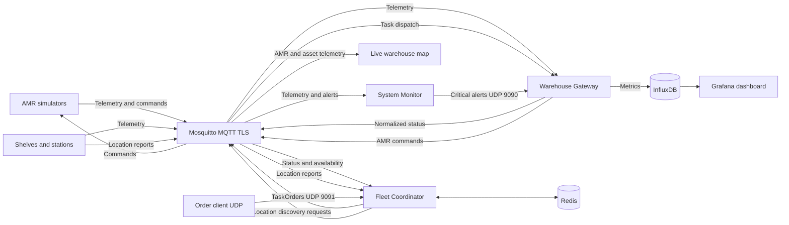

# 🏭 Warehouse Automation System: A Hybrid IoT Architecture for AMR Coordination

**Autoria:** Ivo Rosa, Universidade de Coimbra

Este projeto implementa uma solução completa de **IoT Industrial (IIoT)** para um armazém autónomo simulado. O sistema integra uma frota de **Robôs Móveis Autónomos (AMRs)** e sensores (Prateleiras e Estações) numa arquitetura orientada a eventos.

[cite_start]O foco principal é a gestão de múltiplas fontes de I/O e a garantia de transferência de dados fiável via **MQTT** para telemetria, utilizando **UDP** para sinalização crítica de baixa latência (alertas e *overrides*)[cite: 7, 8, 9].

---

## 🏗️ Arquitetura do Sistema

A arquitetura desacopla a camada operacional "crua" (simulação física) da lógica de gestão de alto nível. [cite_start]Um **Broker MQTT Mosquitto** atua como a espinha dorsal da comunicação, enquanto sockets UDP diretos lidam com sinais críticos[cite: 14, 18].

### Diagrama de Componentes
O sistema é composto pelos seguintes módulos principais:



| Componente | Script Python | Função Principal descrita no Relatório |
| :--- | :--- | :--- |
| **Warehouse Gateway** | `src/warehouse_gateway.py` | **Ponte Central e Tradutor**. Normaliza telemetria, traduz protocolos e armazena métricas no InfluxDB. Aloja o servidor de alertas UDP. |
| **Fleet Coordinator** | `src/fleet_coordinator.py` | Mantém o estado de robôs, prateleiras e estações no Redis, descobre localizações, atribui tarefas pelo algoritmo Hungarian e planeia rotas conjuntas com CBS. |
| **System Monitor** | `src/system_monitor.py` | Analisa telemetria para detetar anomalias e envia alertas com confirmação UDP e fallback MQTT. |
| **AMR Simulator** | `src/amr_robot.py` | Simula a máquina de estados, bateria, Last Will e falhas estocásticas. |
| **Smart Infrastructure** | `src/shelves.py`, `src/loading_station.py` | Simula prateleiras e estações de embalamento. |
| **Live map** | `src/visualizer.py`, `src/web/index.html` | Serve uma planta SVG e recebe telemetria MQTT em direto. |

---

## 🛠️ Especificações Técnicas e Protocolos

### 1. Protocolo de Controlo Binário (Gateway $\to$ AMR)
Para otimizar a largura de banda e garantir processamento determinístico, os comandos de controlo não usam JSON. O Gateway serializa os comandos num **payload binário fixo de 4 bytes** usando a biblioteca `struct` (`format 'BBBB'`).

| Byte | Função | Exemplo / Descrição |
| :--- | :--- | :--- |
| **Byte 0** | `Command Type` | [cite_start]Identifica a ação (e.g., `0x01` executa tarefa, `0x03` força carga)[cite: 35]. |
| **Byte 1** | `Target Shelf` | [cite_start]ID numérico da prateleira de destino[cite: 36]. |
| **Byte 2** | `Target Station` | [cite_start]ID numérico da estação de embalamento[cite: 37]. |
| **Byte 3** | `Quantity` | Quantidade a recolher; usa `0` no comando de carga forçada. |

### 2. Estrutura de Tópicos MQTT (REST-like)
[cite_start]A hierarquia reforça a separação de responsabilidades[cite: 23]:
* **Telemetria:** `warehouse/{GroupID}/{Resource}/{ID}/{Attribute}` (ex: `.../amr/RBT1/status`)
* [cite_start]**Wildcards:** O Monitor e o Debugger subscrevem `warehouse/{GroupID}/#` para ingerir o fluxo completo de dados[cite: 24].
* **Pedido de localização:** `{GroupID}/internal/infrastructure/location/request`. O Coordinator publica um `request_id`; prateleiras e estações subscrevem o canal partilhado.
* **Resposta de localização:** `{GroupID}/internal/infrastructure/location`. Cada resposta identifica `asset_type`, `asset_id`, `location_id`, `x`, `y` e, para prateleiras, `zone_id`.

### 3. Descoberta e gestão de infraestrutura

Ao ligar-se ao MQTT, o Coordinator solicita as localizações conhecidas; repete a descoberta a cada **30 segundos** e volta a solicitá-la quando recebe telemetria de uma prateleira ou estação ainda sem localização. Para pedidos específicos, aplica um intervalo mínimo de **5 segundos** entre tentativas do mesmo ativo. Os simuladores de prateleira e estação publicam a sua identificação e coordenadas no mesmo canal de resposta; a telemetria normal também inclui localização.

`FleetCoordinator.add_shelf()` / `remove_shelf()` e `add_station()` / `remove_station()` mantêm os catálogos no Redis (`warehouse:shelves` e `warehouse:stations`). A remoção apaga o registo ativo e grava uma marca de removido para impedir que a descoberta ou telemetria volte a adicioná-lo. Uma chamada explícita a `add_*` reativa o ativo. Estes são métodos internos Python: não existe atualmente uma API ou interface de utilizador para gestão remota.

### 4. Normalização de Dados (Data Pipeline)
[cite_start]O Gateway atua como um adaptador semântico para padronizar métricas de diferentes zonas do armazém antes da ingestão no InfluxDB[cite: 43]:
* **Input:** Storage-A reporta "unidades", Storage-B reporta "kilogramas".
* **Processo:** Aplicação da função em tempo real: `stock_units = raw_kg / 23`; o consumo da prateleira segue a quantidade da encomenda.
* **Output:** Métricas consistentes para o Dashboard e Coordenador.

---

## 🧠 Lógica de Decisão e Tolerância a Falhas

### Algoritmo de Atribuição (Coordinator)
O Coordenador atribui globalmente tarefas a robôs elegíveis usando o algoritmo Hungarian:
1. **Filtro:** Seleciona robôs online, `IDLE`, com `battery > 15%` e sem tarefa reservada.
2. **Custo:** Minimiza o tempo estimado de rota entre a posição atual arredondada à grelha, a prateleira e a estação. O custo inclui aceleração/travagem por célula e penalizações de rotação de 90°/180°.
3. **Fila persistente:** Encomendas sem robô ou stock disponível permanecem no Redis.

### Mobilidade e tráfego dos AMRs

O mapa de demonstração e as coordenadas lógicas estão definidos em `src/task_allocator.py`; não representam uma planta física. O planeador A* evita a célula de obstáculo configurada em `(5, 5)`. Durante a deslocação, o AMR interpola `x`/`y` com aceleração e travagem, executa curvas com atraso (0,8 s para 90° e 1,5 s para 180°) e publica telemetria aproximadamente a cada **100 ms**. A energia de movimento é calculada pela distância percorrida e as curvas têm um custo adicional. A descoberta mantém metadados de localização dos ativos, mas não atualiza dinamicamente a geometria hardcoded usada pelo planeador.

O Fleet Coordinator calcula, com Conflict-Based Search (CBS), rotas em espaço-tempo para os robôs atribuídos no mesmo lote. O plano inclui as deslocações à prateleira e à estação, com uma janela conservadora para a operação de recolha; o AMR executa os passos temporizados recebidos por MQTT. Como os tempos da simulação e a entrega de mensagens podem divergir do modelo discreto, a verificação distribuída de célula ocupada continua ativa como proteção e pode ainda produzir `STALLED_TRAFFIC`. O planeador limita-se à grelha de demonstração e aos robôs incluídos no lote, pelo que não é uma garantia de segurança física nem elimina esperas em situações fora do modelo.

### Deteção de Anomalias (System Monitor)
O Monitor analisa a telemetria e aciona o Gateway via UDP (Porta 9090) com um comando `FORCE_CHARGE` se:
* **Falha mecânica:** O robô permanece no estado `STALLED` por **30 segundos**, sem mudança da localização lógica.
* [cite_start]**Critical Battery:** A bateria cai abaixo de **15%** sem o robô estar a carregar[cite: 76].

---

## 📊 Visualização e Controlo (Grafana)

Os dados são persistidos no InfluxDB e visualizados no Grafana. O Compose provisiona a fonte de dados e um dashboard de visão geral.

O dashboard provisionado, **Warehouse Overview**, inclui:

* **AMR Battery** e **AMR State Timeline:** bateria e histórico de estados dos robôs (incluindo os estados de movimento, curva e espera de tráfego).
* **Shelf Stock:** histórico do stock reportado pelas prateleiras.
* **Station Throughput:** ocupação das estações de embalamento.
* **Task History** e **System Alerts:** tarefas despachadas e alertas de saúde.

O **Warehouse Control Center** fica disponível em `http://<HOST_IP>:8080` e centraliza a planta SVG/frota em direto e o dashboard Grafana incorporado. O mapa atualiza a cada 300 ms e as métricas a cada 10 segundos. O visualizador subscreve MQTT no servidor, sem expor credenciais ao browser. O host/IP é definido por `HOST_IP` no `.env` (predefinição `127.0.0.1`); as portas externas de MQTT TLS (8883), InfluxDB (8086), Grafana (3000), visualizador (8080) e encomendas UDP (9091) são ligadas a esse endereço. Os containers comunicam entre si pela rede Docker e pelos nomes dos serviços.

Para disponibilizar os serviços numa interface LAN, define `HOST_IP` com o endereço IPv4 dessa interface no `.env` antes de iniciar a stack. O certificado MQTT é regenerado automaticamente com esse IP como SAN e conserva a mesma CA. Redis permanece privado na rede Docker. O Grafana tem acesso anónimo de leitura para permitir a incorporação no painel único; não exponhas o host numa rede não confiável sem restringir o acesso por firewall e rever as credenciais.

---

## 🚀 Instruções de Execução

### Executar a stack completa

Requisitos: Docker Desktop (ou Docker Engine) com Docker Compose v2.

```bash
cp .env.example .env
docker compose up --build --scale amr=4 -d
docker compose ps
```

No PowerShell, copie a configuração com `Copy-Item .env.example .env` e ajuste `HOST_IP` no `.env` para o endereço IPv4 da máquina/interface pretendida (mantém `127.0.0.1` para acesso apenas local). Os valores do `.env.example` são apenas para uma demonstração local; altere todas as palavras-passe e tokens antes de expor serviços ou usar fora da máquina local. Gere também uma chave forte para `UDP_HMAC_SECRET` (por exemplo, `python -c "import secrets; print(secrets.token_hex(32))"`) e coloque-a no `.env`; a mesma chave tem de estar disponível para o Gateway, Coordinator, System Monitor e cliente de encomendas. O ficheiro `.env` está ignorado pelo Git.

Um único comando inicia Mosquitto com TLS e autenticação, InfluxDB, Redis, Grafana, Gateway, Coordinator, System Monitor, simuladores de prateleiras/estações e quatro AMRs. Para alterar a dimensão da frota, mude `--scale amr=4`.

Para executar uma simulação local de carga de pedidos, com intervalos, artigos, quantidades e estações variáveis:

```bash
bash src/popular_influx.sh
```

O simulador estima tempos de deslocação com aceleração e travagem, penaliza curvas e publica coordenadas X/Y a cada 100 ms. O Coordinator envia trajetórias CBS para as tarefas atribuídas em conjunto; o AMR mantém A* e a verificação de tráfego como fallback. A bateria é consumida durante movimento/manuseamento e nas curvas, e a estação ajusta o processamento ao tamanho da encomenda. O protocolo de controlo interno usa quatro bytes para transportar também a quantidade pedida.

Consulte **Descoberta e gestão de infraestrutura** para os tópicos, intervalos e métodos internos de gestão de prateleiras e estações.

* Dashboard único (mapa, frota e métricas): `http://${HOST_IP}:8080`.
* Grafana para administração: `http://${HOST_IP}:3000` (credenciais iniciais no `.env`).
* InfluxDB API/UI: `http://${HOST_IP}:8086`.
* Broker MQTT TLS: `${HOST_IP}:8883`; a CA local fica guardada num volume Docker.
* As encomendas UDP do host são enviadas para `${HOST_IP}:9091`:
  ```bash
  python src/client_order_injector.py --item item_A --qty 5 --station P1
  ```
* `docker compose down` pára a stack e mantém os dados. `docker compose down -v` também apaga os dados persistidos.

### Componentes e persistência

O Coordinator persiste estado de robôs, prateleiras, estações, reservas, encomendas pendentes e ativos removidos no Redis com AOF. O alocador usa o algoritmo Hungarian para minimizar globalmente o tempo de rota estimado; CBS planeia em conjunto as rotas do lote, sobre a grelha de demonstração definida em `src/task_allocator.py`, não um mapa físico do armazém.

As mensagens de entrada são validadas com modelos Pydantic. Telemetria e comandos MQTT usam QoS 1; os AMRs publicam Last Will and Testament para sinalizar desconexões. As posições contínuas dos AMRs são campos `x` e `y` da medição `Robots_status` no InfluxDB. Ordens UDP (porta 9091) e alertas UDP/ACK (porta 9090) usam HMAC-SHA256 com `UDP_HMAC_SECRET`, timestamps e nonces; mensagens inválidas, com mais de 30 segundos ou repetidas durante a execução são rejeitadas. A cache anti-replay é em memória e perde-se ao reiniciar o serviço. Alertas críticos continuam a usar repetição e fallback MQTT caso não recebam confirmação. A chave de demonstração incluída no `.env.example` é pública e não serve para proteger uma instalação exposta.

### Desenvolvimento e validação

```bash
python -m pip install -r requirements-dev.txt
ruff check .
ruff format --check .
mypy
pytest -q
```

O GitHub Actions executa lint, formatação, mypy e pytest em cada push e pull request.
