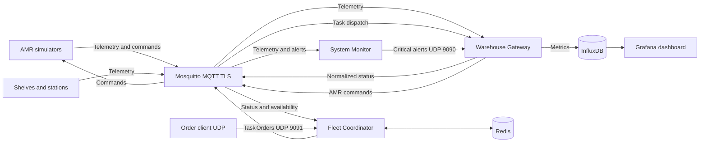

# 🏭 Warehouse Automation System: A Hybrid IoT Architecture for AMR Coordination

**Autoria:** Ivo Rosa, Universidade de Coimbra

Este projeto implementa uma solução completa de **IoT Industrial (IIoT)** para um armazém autónomo simulado. O sistema integra uma frota de **Robôs Móveis Autónomos (AMRs)** e sensores (Prateleiras e Estações) numa arquitetura orientada a eventos.

[cite_start]O foco principal é a gestão de múltiplas fontes de I/O e a garantia de transferência de dados fiável via **MQTT** para telemetria, utilizando **UDP** para sinalização crítica de baixa latência (alertas e *overrides*)[cite: 7, 8, 9].

---

## 🏗️ Arquitetura do Sistema

A arquitetura desacopla a camada operacional "crua" (simulação física) da lógica de gestão de alto nível. [cite_start]Um **Broker MQTT Mosquitto** atua como a espinha dorsal da comunicação, enquanto sockets UDP diretos lidam com sinais críticos[cite: 14, 18].

### Diagrama de Componentes
O sistema é composto pelos seguintes módulos principais:



| Componente | Script Python | Função Principal descrita no Relatório |
| :--- | :--- | :--- |
| **Warehouse Gateway** | `src/warehouse_gateway.py` | **Ponte Central e Tradutor**. Normaliza telemetria, traduz protocolos e armazena métricas no InfluxDB. Aloja o servidor de alertas UDP. |
| **Fleet Coordinator** | `src/fleet_coordinator.py` | Mantém o estado persistente da frota no Redis e atribui tarefas pelo algoritmo Hungarian, com custos de rota estimados. |
| **System Monitor** | `src/system_monitor.py` | Analisa telemetria para detetar anomalias e envia alertas com confirmação UDP e fallback MQTT. |
| **AMR Simulator** | `src/amr_robot.py` | Simula a máquina de estados, bateria, Last Will e falhas estocásticas. |
| **Smart Infrastructure** | `src/shelves.py`, `src/loading_station.py` | Simula prateleiras e estações de embalamento. |

---

## 🛠️ Especificações Técnicas e Protocolos

### 1. Protocolo de Controlo Binário (Gateway $\to$ AMR)
Para otimizar a largura de banda e garantir processamento determinístico, os comandos de controlo não usam JSON. O Gateway serializa os comandos num **payload binário fixo de 4 bytes** usando a biblioteca `struct` (`format 'BBBB'`).

| Byte | Função | Exemplo / Descrição |
| :--- | :--- | :--- |
| **Byte 0** | `Command Type` | [cite_start]Identifica a ação (e.g., `0x01` executa tarefa, `0x03` força carga)[cite: 35]. |
| **Byte 1** | `Target Shelf` | [cite_start]ID numérico da prateleira de destino[cite: 36]. |
| **Byte 2** | `Target Station` | [cite_start]ID numérico da estação de embalamento[cite: 37]. |
| **Byte 3** | `Quantity` | Quantidade a recolher; usa `0` no comando de carga forçada. |

### 2. Estrutura de Tópicos MQTT (REST-like)
[cite_start]A hierarquia reforça a separação de responsabilidades[cite: 23]:
* **Telemetria:** `warehouse/{GroupID}/{Resource}/{ID}/{Attribute}` (ex: `.../amr/RBT1/status`)
* [cite_start]**Wildcards:** O Monitor e o Debugger subscrevem `warehouse/{GroupID}/#` para ingerir o fluxo completo de dados[cite: 24].

### 3. Normalização de Dados (Data Pipeline)
[cite_start]O Gateway atua como um adaptador semântico para padronizar métricas de diferentes zonas do armazém antes da ingestão no InfluxDB[cite: 43]:
* **Input:** Storage-A reporta "unidades", Storage-B reporta "kilogramas".
* **Processo:** Aplicação da função em tempo real: `stock_units = raw_kg / 23`; o consumo da prateleira segue a quantidade da encomenda.
* **Output:** Métricas consistentes para o Dashboard e Coordenador.

---

## 🧠 Lógica de Decisão e Tolerância a Falhas

### Algoritmo de Atribuição (Coordinator)
O Coordenador atribui globalmente tarefas a robôs elegíveis usando o algoritmo Hungarian:
1. **Filtro:** Seleciona robôs online, `IDLE`, com `battery > 15%` e sem tarefa reservada.
2. **Custo:** Minimiza a distância Manhattan estimada entre a posição do robô, a prateleira e a estação.
3. **Fila persistente:** Encomendas sem robô ou stock disponível permanecem no Redis.

### Deteção de Anomalias (System Monitor)
O Monitor garante a fiabilidade analisando a telemetria e acionando o Gateway via UDP (Porta 9090) com um comando `FORCE_CHARGE` se:
* [cite_start]**Stall Detection:** O robô reporta `MOVING` mas a localização não muda há **30 segundos**[cite: 75].
* [cite_start]**Critical Battery:** A bateria cai abaixo de **15%** sem o robô estar a carregar[cite: 76].

---

## 📊 Visualização e Controlo (Grafana)

Os dados são persistidos no InfluxDB e visualizados no Grafana. O Compose provisiona a fonte de dados e um dashboard de visão geral.

O dashboard provisionado, **Warehouse Overview**, inclui:

* **AMR Battery** e **AMR State Timeline:** bateria e histórico de estados dos robôs.
* **Shelf Stock:** histórico do stock reportado pelas prateleiras.
* **Station Throughput:** ocupação das estações de embalamento.
* **Task History** e **System Alerts:** tarefas despachadas e alertas de saúde.

---

## 🚀 Instruções de Execução

### Executar a stack completa

Requisitos: Docker Desktop (ou Docker Engine) com Docker Compose v2.

```bash
cp .env.example .env
docker compose up --build --scale amr=4 -d
docker compose ps
```

No PowerShell, copie a configuração com `Copy-Item .env.example .env`. Os valores do `.env.example` são apenas para uma demonstração local; altere todas as palavras-passe e tokens antes de expor serviços ou usar fora da máquina local. O ficheiro `.env` está ignorado pelo Git.

Um único comando inicia Mosquitto com TLS e autenticação, InfluxDB, Redis, Grafana, Gateway, Coordinator, System Monitor, simuladores de prateleiras/estações e quatro AMRs. Para alterar a dimensão da frota, mude `--scale amr=4`.

Para executar uma simulação local de carga de pedidos, com intervalos, artigos, quantidades e estações variáveis:

```bash
bash src/popular_influx.sh
```

O simulador estima tempos de deslocação com aceleração e travagem, penaliza curvas, publica coordenadas X/Y a cada 100 ms e usa um planeador A* com uma célula de obstáculo no mapa de demonstração. Os AMRs anunciam a próxima célula e aguardam quando esta está ocupada ou reservada. A bateria é consumida durante movimento/manuseamento e nas curvas, e a estação ajusta o processamento ao tamanho da encomenda. O protocolo de controlo interno usa quatro bytes para transportar também a quantidade pedida.

O Coordinator descobre prateleiras e estações no tópico MQTT partilhado `internal/infrastructure/location`: envia pedidos no tópico `internal/infrastructure/location/request` ao arrancar, periodicamente e quando recebe telemetria de um ativo ainda sem localização. Os simuladores respondem com ID e coordenadas. `FleetCoordinator.add_shelf`/`remove_shelf` e `add_station`/`remove_station` atualizam o catálogo persistido no Redis; remoções ficam marcadas para não serem reaparecer automaticamente por telemetria.

* Grafana: <http://localhost:3000> (credenciais iniciais no `.env`).
* O broker MQTT TLS fica disponível apenas em `localhost:8883`; a CA local é criada no primeiro arranque e guardada num volume Docker.
* As encomendas UDP do host são enviadas para `127.0.0.1:9091`:
  ```bash
  python src/client_order_injector.py --item item_A --qty 5 --station P1
  ```
* `docker compose down` pára a stack e mantém os dados. `docker compose down -v` também apaga os dados persistidos.

### Componentes e persistência

O Coordinator persiste estado de robôs, prateleiras, reservas e encomendas pendentes no Redis com AOF. O alocador usa o algoritmo Hungarian para minimizar globalmente o custo das tarefas disponíveis; o custo de rota Manhattan usa uma grelha de demonstração definida em `src/task_allocator.py`, não um mapa físico do armazém.

As mensagens de entrada são validadas com modelos Pydantic. Telemetria e comandos MQTT usam QoS 1; os AMRs publicam Last Will and Testament para sinalizar desconexões. Alertas críticos usam UDP com ACK e repetição, e recorrem a MQTT QoS 1 caso não recebam confirmação.

### Desenvolvimento e validação

```bash
python -m pip install -r requirements-dev.txt
ruff check .
ruff format --check .
mypy
pytest -q
```

O GitHub Actions executa lint, formatação, mypy e pytest em cada push e pull request.
